# “口腔助手”小程序的设计与实现1171u--论文

> 🎓 **计算机毕业设计 · “口腔助手”小程序的设计与实现1171u--论文**
>
> 本仓库只放**项目介绍 + 运行截图**（截图是站点带水印的原图，存在仓库 `images/` 里）。
>
> 👉 **完整可运行源码 / 数据库脚本 / 部署文档：[点我获取](https://geekcode.top/archives/%E2%80%9C%E5%8F%A3%E8%85%94%E5%8A%A9%E6%89%8B%E2%80%9D%E5%B0%8F%E7%A8%8B%E5%BA%8F%E7%9A%84%E8%AE%BE%E8%AE%A1%E4%B8%8E%E5%AE%9E%E7%8E%B01171u-%E8%AE%BA%E6%96%87?utm_source=github)**
>
> 💬 咨询微信：**ir9372**　|　🌐 更多项目：[极客代码 geekcode.top](https://geekcode.top/?utm_source=github)
>
> 📌 项目详情页：<https://geekcode.top/archives/%E2%80%9C%E5%8F%A3%E8%85%94%E5%8A%A9%E6%89%8B%E2%80%9D%E5%B0%8F%E7%A8%8B%E5%BA%8F%E7%9A%84%E8%AE%BE%E8%AE%A1%E4%B8%8E%E5%AE%9E%E7%8E%B01171u-%E8%AE%BA%E6%96%87?utm_source=github>

<table><td width="230" align="center"> <b>扫码加微信 ir9372</b></td><td valign="middle">📦 源码 = 项目介绍 + 全部运行截图 + 数据库 + 部署文档 👉 点上方任意截图，直接跳到 <b>极客代码 geekcode.top</b> 详情页</td></table>

---

<h1>“口腔助手”小程序的设计与实现_1171u--论文</h1>
<h2>项目概述</h2>

“口腔助手”小程序的设计与实现旨在构建一个集口腔健康科普、在线问诊预约及医患互动于一体的综合性服务平台。项目核心目标是通过移动端便捷入口，解决传统口腔医疗信息不对称及预约流程繁琐的问题。系统主要面向普通患者用户与医疗机构管理员两类群体。对于患者而言，平台提供保健知识浏览、医生信息查询、在线问诊发起及预约管理等功能；对于管理员而言，后台支持对内容、用户、医生及业务数据的全面管控。技术架构上，前端采用微信小程序原生开发结合 Vue 框架特性，后端基于 Java Spring Boot 生态，通过 RESTful API 实现前后端数据交互，确保系统的响应速度与可维护性。

<h2>技术架构</h2>

本项目采用典型的前后端分离架构，具体设计如下：

<h3>1. 总体架构图</h3>

<a href="https://geekcode.top/archives/%E2%80%9C%E5%8F%A3%E8%85%94%E5%8A%A9%E6%89%8B%E2%80%9D%E5%B0%8F%E7%A8%8B%E5%BA%8F%E7%9A%84%E8%AE%BE%E8%AE%A1%E4%B8%8E%E5%AE%9E%E7%8E%B01171u-%E8%AE%BA%E6%96%87?utm_source=github" title="查看完整源码">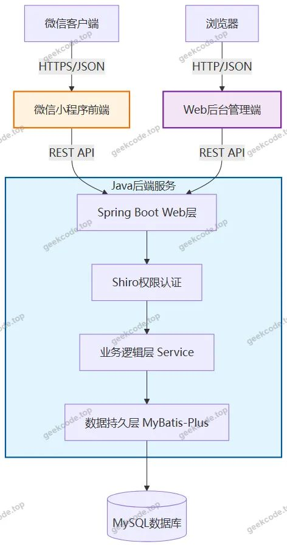</a>

<h3>2. 核心技术选型理由</h3>
<ul>
<li><strong>后端框架</strong>：选用 <strong>Spring Boot</strong> 作为核心容器，利用其自动配置特性简化部署流程；集成 <strong>MyBatis-Plus</strong> 以增强 ORM 能力，减少基础 CRUD 代码冗余，提升开发效率；引入 <strong>Apache Shiro</strong> 进行安全控制，实现细粒度的权限管理与身份认证。</li>
<li><strong>前端技术</strong>：小程序端基于微信生态标准开发，保证用户体验的一致性；Web 管理端采用 Vue 体系（根据项目类型 vue-integrated 推断），通过组件化开发提高界面复用率。</li>
<li><strong>通信机制</strong>：前后端完全解耦，通过标准的 <strong>RESTful API</strong> 进行数据交换。所有接口均返回 JSON 格式数据，便于前端解析与渲染。</li>
<li><strong>数据存储</strong>：使用 <strong>MySQL</strong> 关系型数据库存储用户信息、医生资料、保健文章、预约记录等结构化数据，并通过 <code>mysql-connector-java</code> 驱动连接。</li>
</ul>
<h3>3. 数据库设计要点</h3>

数据库设计遵循第三范式，主要实体包括：

<ul>
<li><strong>用户表 (yonghu)</strong>：存储注册用户的基本信息与登录凭证。</li>
<li><strong>医生表 (yisheng)</strong>：记录医生的专业背景、擅长领域及联系方式。</li>
<li><strong>保健知识表 (baojianzhishi)</strong>：存储口腔护理相关文章内容。</li>
<li><strong>评论表 (discussbaojianzhishi)</strong>：关联保健知识与用户，存储评论内容。</li>
<li><strong>预约信息表 (yuyuexinxi)</strong>：记录用户的问诊预约状态与时间。</li>
<li><strong>在线问诊表 (zaixianwenzhen)</strong>：存储医患沟通记录或咨询请求。</li>
<li><strong>其他辅助表</strong>：包括新闻公告 (news)、关于我们 (aboutus)、口腔历史 (kouqianglishi)、系统简介 (systemintro)、用户反馈 (yonghufankui) 及系统配置 (config)。</li>
</ul>
<h2>功能模块</h2>

根据源码中的 Controller 列表、路由配置及截图所示功能，系统划分为以下两大模块：

<h3>1. 微信小程序用户端</h3>

该模块面向普通患者用户，侧重于信息的获取与服务的使用。

<ul>
<li><strong>用户认证模块</strong>：</li>
<li><strong>注册与登录</strong>：提供用户账号创建及身份验证入口。</li>
<li><strong>个人信息管理</strong>：允许用户查看和修改个人资料。</li>
<li><strong>健康资讯模块</strong>：</li>
<li><strong>首页展示</strong>：聚合展示最新保健知识、热门医生及系统公告。</li>
<li><strong>保健知识浏览</strong>：分类展示口腔护理文章，支持查看详情。</li>
<li><strong>口腔历史</strong>：展示口腔医学发展史及相关科普内容。</li>
<li><strong>医疗公告</strong>：发布医院通知或行业重要资讯。</li>
<li><strong>医疗服务模块</strong>：</li>
<li><strong>医生查询</strong>：浏览医生列表，查看医生简介与专长。</li>
<li><strong>在线问诊</strong>：发起咨询请求，查看问诊历史记录。</li>
<li><strong>预约管理</strong>：创建新的就诊预约，查看和管理已有的预约信息列表。</li>
<li><strong>互动反馈模块</strong>：</li>
<li><strong>用户反馈</strong>：提交对平台服务的建议或投诉。</li>
<li><strong>知识评论</strong>：针对保健知识文章发表评论，参与社区讨论。</li>
</ul>
<h3>2. Web 后台管理端</h3>

该模块面向系统管理员，侧重于内容的维护、业务的审核及数据的监控。

<ul>
<li><strong>系统管理模块</strong>：</li>
<li><strong>登录页</strong>：管理员身份验证入口。</li>
<li><strong>配置文件</strong>：管理系统基础参数设置。</li>
<li><strong>系统简介/关于我们</strong>：编辑和维护展示在前端的静态介绍页面内容。</li>
<li><strong>内容管理模块</strong>：</li>
<li><strong>保健知识管理</strong>：新增、编辑、删除口腔保健文章。</li>
<li><strong>保健知识评论管理</strong>：审核用户发表的评论，处理违规内容。</li>
<li><strong>医疗公告管理</strong>：发布和管理新闻公告信息。</li>
<li><strong>口腔历史管理</strong>：维护口腔历史板块的内容。</li>
<li><strong>业务管理模块</strong>：</li>
<li><strong>医生管理</strong>：录入、更新或删除医生档案信息。</li>
<li><strong>用户管理</strong>：查看注册用户列表，管理用户状态。</li>
<li><strong>在线问诊管理</strong>：查看和处理用户发起的在线咨询记录。</li>
<li><strong>预约信息管理</strong>：审核、确认或取消用户的就诊预约申请。</li>
<li><strong>用户反馈管理</strong>：收集并处理用户提交的反馈意见。</li>
</ul>
<h2>用户角色与权限</h2>

系统主要包含两种角色：<strong>普通用户</strong>（小程序端）和<strong>管理员</strong>（Web 后台端）。

<h3>1. 普通用户 (User)</h3>
<ul>
<li><strong>访问范围</strong>：仅限微信小程序前端。</li>
<li><strong>权限描述</strong>：</li>
<li><strong>基础权限</strong>：注册、登录、退出、修改个人信息。</li>
<li><strong>读取权限</strong>：浏览所有公开的保健知识、医生列表、口腔历史、系统公告及自身相关的预约和问诊记录。</li>
<li><strong>写入权限</strong>：</li>
<li>发起在线问诊。</li>
<li>创建和取消个人预约。</li>
<li>提交用户反馈。</li>
<li>对保健知识文章发表评论。</li>
<li><strong>限制</strong>：无法访问任何管理功能，无法修改他人数据，无法直接发布或编辑文章内容。</li>
</ul>
<h3>2. 管理员 (Admin)</h3>
<ul>
<li><strong>访问范围</strong>：仅限 Web 后台管理端。</li>
<li><strong>权限描述</strong>：</li>
<li><strong>超级权限</strong>：拥有系统最高控制权。</li>
<li><strong>内容发布与维护</strong>：全权负责保健知识、医生信息、口腔历史、系统简介、关于我们的增删改查。</li>
<li><strong>业务审批与管理</strong>：</li>
<li>管理所有用户账户（查看、禁用等）。</li>
<li>处理所有在线问诊记录。</li>
<li>审核和管理所有预约信息。</li>
<li>回复或归档用户反馈。</li>
<li>管理保健知识的评论（删除不良评论）。</li>
<li><strong>系统配置</strong>：修改系统全局配置参数。</li>
<li><strong>限制</strong>：通常不直接在小程序端进行患者视角的操作，专注于数据治理与服务调度。</li>
</ul>
<h2>项目特色与创新点</h2>
<ol>
<li><strong>闭环的服务体验</strong>：项目打通了从“健康教育（保健知识/口腔历史）”到“医疗服务（医生查询/在线问诊/预约）”再到“反馈改进（用户反馈/评论）”的全链路，形成了完整的口腔健康管理闭环。</li>
<li><strong>轻量级即时交互</strong>：利用微信小程序无需安装、即用即走的特性，降低了患者使用门槛；同时集成在线问诊与预约功能，实现了医患之间的轻量化即时连接，提升了服务效率。</li>
<li><strong>动静结合的内容运营</strong>：后台提供了丰富的内容管理接口（如保健知识、评论管理），使得非技术人员也能轻松维护专业的口腔科普内容，保证了平台信息的时效性与专业性。</li>
<li><strong>安全的权限隔离</strong>：基于 Shiro 框架构建的安全体系，严格区分了前台用户与后台管理员的操作边界，确保了医疗敏感数据（如预约信息、用户隐私）的安全性。</li>
</ol>
<h2>部署环境</h2>

为确保系统正常运行，需准备以下软硬件环境：

<h3>1. 硬件要求</h3>
<ul>
<li>CPU：双核及以上处理器。</li>
<li>内存：4GB RAM 及以上。</li>
<li>硬盘：至少 20GB 可用存储空间。</li>
</ul>
<h3>2. 软件环境</h3>
<ul>
<li><strong>操作系统</strong>：Windows 10/11 或 Linux (CentOS 7+)。</li>
<li><strong>JDK 版本</strong>：Java Development Kit 1.8 (JDK 8) 或更高兼容版本。</li>
<li><strong>数据库</strong>：MySQL 5.7 或 MySQL 8.0。</li>
<li><strong>构建工具</strong>：Maven 3.6+（用于后端依赖管理）。</li>
<li><strong>前端开发工具</strong>：</li>
<li>微信开发者工具（Stable Build 版本）。</li>
<li>Node.js 环境（若前端涉及 npm 包管理）。</li>
<li><strong>服务器容器</strong>：内置 Tomcat (由 Spring Boot 提供) 或独立部署的 Nginx/Apache（用于生产环境静态资源托管及反向代理）。</li>
</ul>
<h3>3. 关键配置文件说明</h3>
<ul>
<li><strong>application.yml / application.properties</strong>：需配置 MySQL 连接地址、用户名、密码，以及文件上传路径等参数。</li>
<li><strong>小程序 AppID</strong>：需在微信公众平台申请并配置正确的 AppID 以启用真机调试与发布。</li>
</ul>
<h2>五、技术特性</h2>
<ul>
<li>前后端集成部署，前端资源打包至后端 static 目录</li>
<li>使用 MyBatis-Plus 简化数据访问层开发</li>
<li>集成 Shiro 权限框架实现角色权限控制</li>
</ul>
<h2>六、功能模块截图</h2>
<h3>微信小程序用户端</h3>

<figure><a href="https://geekcode.top/archives/%E2%80%9C%E5%8F%A3%E8%85%94%E5%8A%A9%E6%89%8B%E2%80%9D%E5%B0%8F%E7%A8%8B%E5%BA%8F%E7%9A%84%E8%AE%BE%E8%AE%A1%E4%B8%8E%E5%AE%9E%E7%8E%B01171u-%E8%AE%BA%E6%96%87?utm_source=github" title="查看完整源码">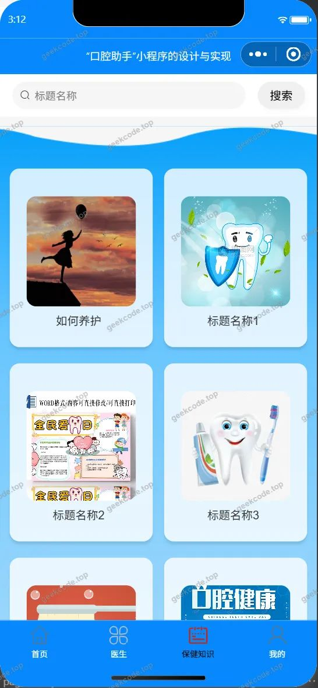</a><figcaption>小程序-保健知识</figcaption></figure>
<figure><a href="https://geekcode.top/archives/%E2%80%9C%E5%8F%A3%E8%85%94%E5%8A%A9%E6%89%8B%E2%80%9D%E5%B0%8F%E7%A8%8B%E5%BA%8F%E7%9A%84%E8%AE%BE%E8%AE%A1%E4%B8%8E%E5%AE%9E%E7%8E%B01171u-%E8%AE%BA%E6%96%87?utm_source=github" title="查看完整源码">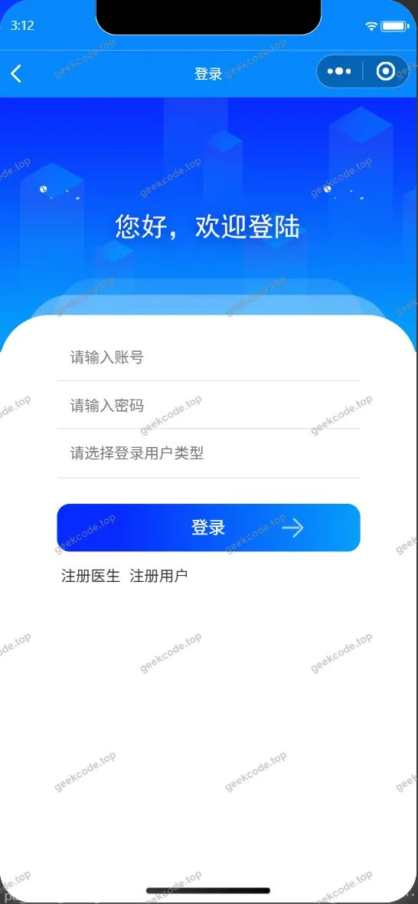</a><figcaption>小程序-登录</figcaption></figure>
<figure><a href="https://geekcode.top/archives/%E2%80%9C%E5%8F%A3%E8%85%94%E5%8A%A9%E6%89%8B%E2%80%9D%E5%B0%8F%E7%A8%8B%E5%BA%8F%E7%9A%84%E8%AE%BE%E8%AE%A1%E4%B8%8E%E5%AE%9E%E7%8E%B01171u-%E8%AE%BA%E6%96%87?utm_source=github" title="查看完整源码">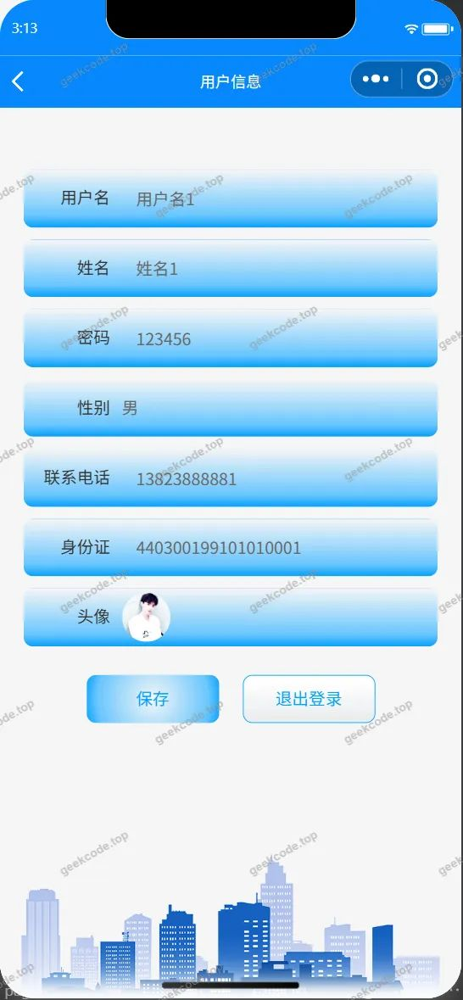</a><figcaption>小程序-个人信息</figcaption></figure>
<figure><a href="https://geekcode.top/archives/%E2%80%9C%E5%8F%A3%E8%85%94%E5%8A%A9%E6%89%8B%E2%80%9D%E5%B0%8F%E7%A8%8B%E5%BA%8F%E7%9A%84%E8%AE%BE%E8%AE%A1%E4%B8%8E%E5%AE%9E%E7%8E%B01171u-%E8%AE%BA%E6%96%87?utm_source=github" title="查看完整源码">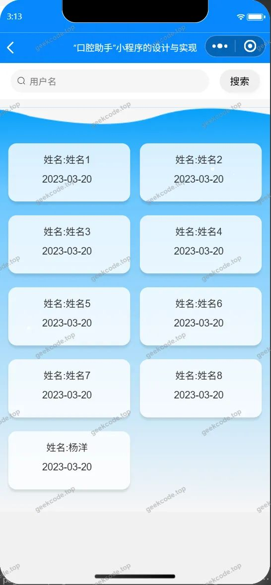</a><figcaption>小程序-口腔历史列表</figcaption></figure>
<figure><figcaption>小程序-首页</figcaption></figure>
<figure><figcaption>小程序-我的</figcaption></figure>
<figure><figcaption>小程序-医生</figcaption></figure>
<figure><a href="https://geekcode.top/archives/%E2%80%9C%E5%8F%A3%E8%85%94%E5%8A%A9%E6%89%8B%E2%80%9D%E5%B0%8F%E7%A8%8B%E5%BA%8F%E7%9A%84%E8%AE%BE%E8%AE%A1%E4%B8%8E%E5%AE%9E%E7%8E%B01171u-%E8%AE%BA%E6%96%87?utm_source=github" title="查看完整源码">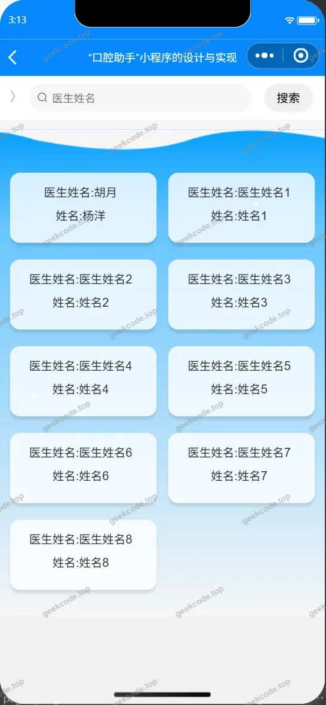</a><figcaption>小程序-用户反馈列表</figcaption></figure>
<figure><a href="https://geekcode.top/archives/%E2%80%9C%E5%8F%A3%E8%85%94%E5%8A%A9%E6%89%8B%E2%80%9D%E5%B0%8F%E7%A8%8B%E5%BA%8F%E7%9A%84%E8%AE%BE%E8%AE%A1%E4%B8%8E%E5%AE%9E%E7%8E%B01171u-%E8%AE%BA%E6%96%87?utm_source=github" title="查看完整源码">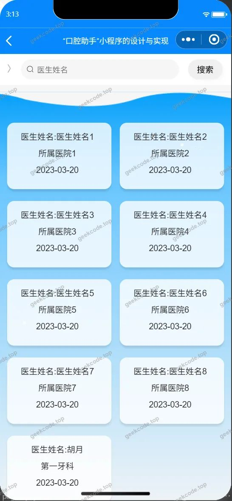</a><figcaption>小程序-预约信息列表</figcaption></figure>
<figure><figcaption>小程序-在线问诊列表</figcaption></figure>
<figure><a href="https://geekcode.top/archives/%E2%80%9C%E5%8F%A3%E8%85%94%E5%8A%A9%E6%89%8B%E2%80%9D%E5%B0%8F%E7%A8%8B%E5%BA%8F%E7%9A%84%E8%AE%BE%E8%AE%A1%E4%B8%8E%E5%AE%9E%E7%8E%B01171u-%E8%AE%BA%E6%96%87?utm_source=github" title="查看完整源码">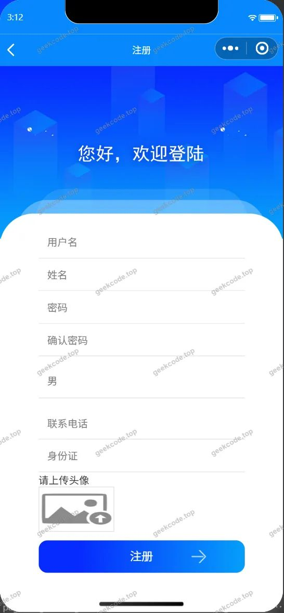</a><figcaption>小程序-注册</figcaption></figure>

<h3>微信小程序管理端</h3>

<figure><figcaption>小程序-管理端-关于我们列表</figcaption></figure>
<figure><figcaption>小程序-管理端-系统简介列表</figcaption></figure>
<figure><figcaption>小程序-管理端-医疗公告列表</figcaption></figure>
<figure><figcaption>小程序-管理端-用户列表</figcaption></figure>

<h3>后台管理端</h3>
<h4>后台-关于我们</h4>

<a href="https://geekcode.top/archives/%E2%80%9C%E5%8F%A3%E8%85%94%E5%8A%A9%E6%89%8B%E2%80%9D%E5%B0%8F%E7%A8%8B%E5%BA%8F%E7%9A%84%E8%AE%BE%E8%AE%A1%E4%B8%8E%E5%AE%9E%E7%8E%B01171u-%E8%AE%BA%E6%96%87?utm_source=github" title="查看完整源码">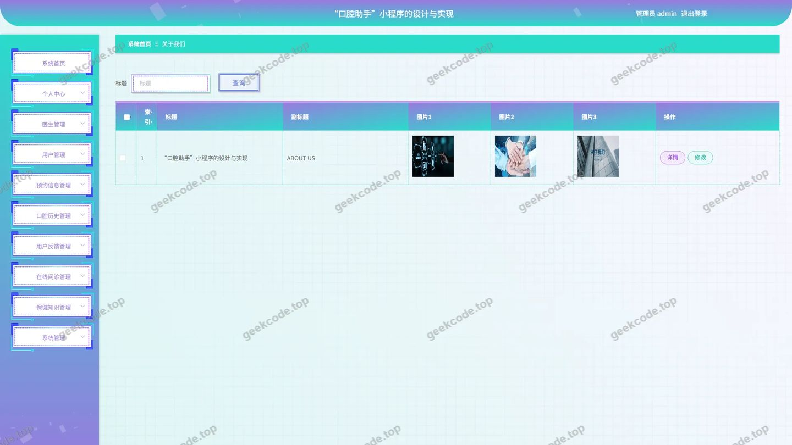</a>

<h4>后台-保健知识</h4>

<a href="https://geekcode.top/archives/%E2%80%9C%E5%8F%A3%E8%85%94%E5%8A%A9%E6%89%8B%E2%80%9D%E5%B0%8F%E7%A8%8B%E5%BA%8F%E7%9A%84%E8%AE%BE%E8%AE%A1%E4%B8%8E%E5%AE%9E%E7%8E%B01171u-%E8%AE%BA%E6%96%87?utm_source=github" title="查看完整源码">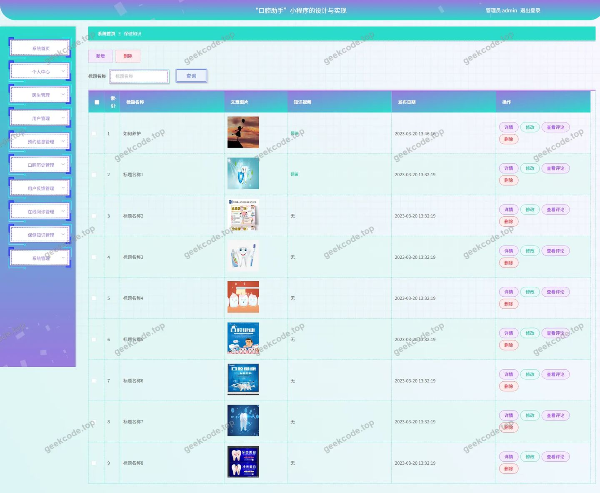</a>

<h4>后台-系统配置</h4>

<a href="https://geekcode.top/archives/%E2%80%9C%E5%8F%A3%E8%85%94%E5%8A%A9%E6%89%8B%E2%80%9D%E5%B0%8F%E7%A8%8B%E5%BA%8F%E7%9A%84%E8%AE%BE%E8%AE%A1%E4%B8%8E%E5%AE%9E%E7%8E%B01171u-%E8%AE%BA%E6%96%87?utm_source=github" title="查看完整源码">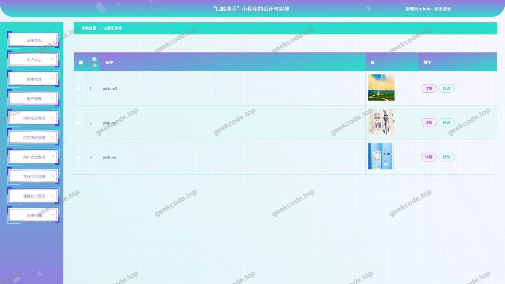</a>

<h4>后台-保健知识评论</h4>

<a href="https://geekcode.top/archives/%E2%80%9C%E5%8F%A3%E8%85%94%E5%8A%A9%E6%89%8B%E2%80%9D%E5%B0%8F%E7%A8%8B%E5%BA%8F%E7%9A%84%E8%AE%BE%E8%AE%A1%E4%B8%8E%E5%AE%9E%E7%8E%B01171u-%E8%AE%BA%E6%96%87?utm_source=github" title="查看完整源码">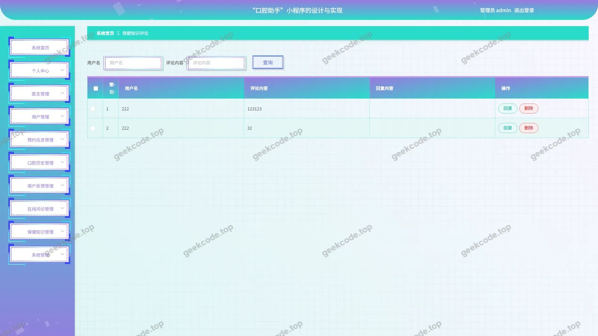</a>

<h4>后台首页</h4>

<a href="https://geekcode.top/archives/%E2%80%9C%E5%8F%A3%E8%85%94%E5%8A%A9%E6%89%8B%E2%80%9D%E5%B0%8F%E7%A8%8B%E5%BA%8F%E7%9A%84%E8%AE%BE%E8%AE%A1%E4%B8%8E%E5%AE%9E%E7%8E%B01171u-%E8%AE%BA%E6%96%87?utm_source=github" title="查看完整源码">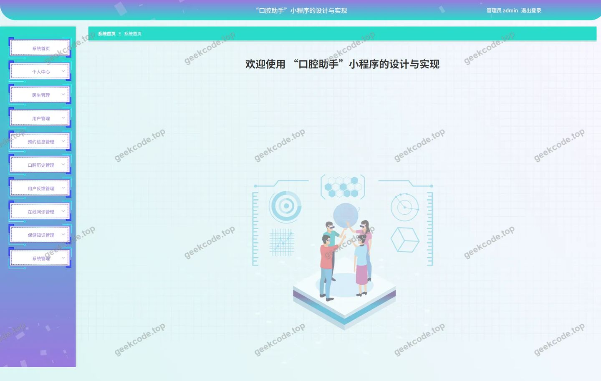</a>

<h4>后台-口腔历史</h4>

<a href="https://geekcode.top/archives/%E2%80%9C%E5%8F%A3%E8%85%94%E5%8A%A9%E6%89%8B%E2%80%9D%E5%B0%8F%E7%A8%8B%E5%BA%8F%E7%9A%84%E8%AE%BE%E8%AE%A1%E4%B8%8E%E5%AE%9E%E7%8E%B01171u-%E8%AE%BA%E6%96%87?utm_source=github" title="查看完整源码">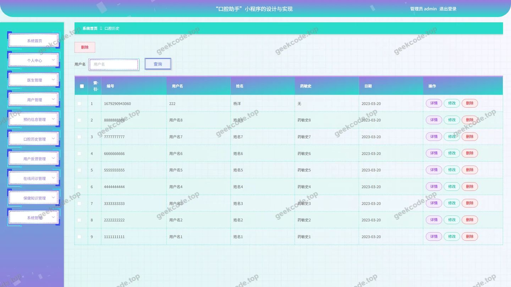</a>

<h4>后台-登录</h4>

<a href="https://geekcode.top/archives/%E2%80%9C%E5%8F%A3%E8%85%94%E5%8A%A9%E6%89%8B%E2%80%9D%E5%B0%8F%E7%A8%8B%E5%BA%8F%E7%9A%84%E8%AE%BE%E8%AE%A1%E4%B8%8E%E5%AE%9E%E7%8E%B01171u-%E8%AE%BA%E6%96%87?utm_source=github" title="查看完整源码">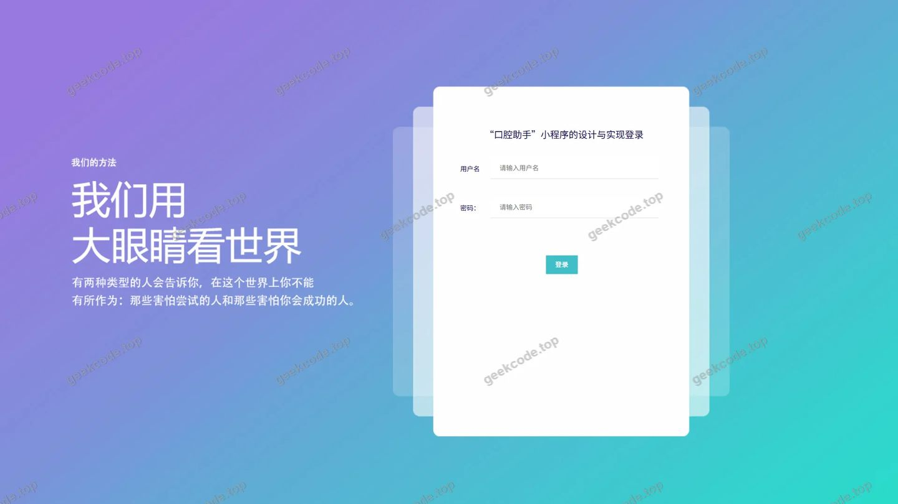</a>

<h4>后台-公告信息</h4>

<a href="https://geekcode.top/archives/%E2%80%9C%E5%8F%A3%E8%85%94%E5%8A%A9%E6%89%8B%E2%80%9D%E5%B0%8F%E7%A8%8B%E5%BA%8F%E7%9A%84%E8%AE%BE%E8%AE%A1%E4%B8%8E%E5%AE%9E%E7%8E%B01171u-%E8%AE%BA%E6%96%87?utm_source=github" title="查看完整源码">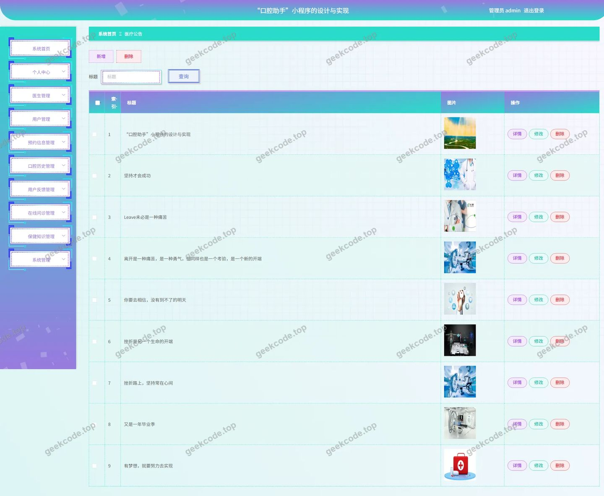</a>

<h4>后台-医生</h4>

<a href="https://geekcode.top/archives/%E2%80%9C%E5%8F%A3%E8%85%94%E5%8A%A9%E6%89%8B%E2%80%9D%E5%B0%8F%E7%A8%8B%E5%BA%8F%E7%9A%84%E8%AE%BE%E8%AE%A1%E4%B8%8E%E5%AE%9E%E7%8E%B01171u-%E8%AE%BA%E6%96%87?utm_source=github" title="查看完整源码">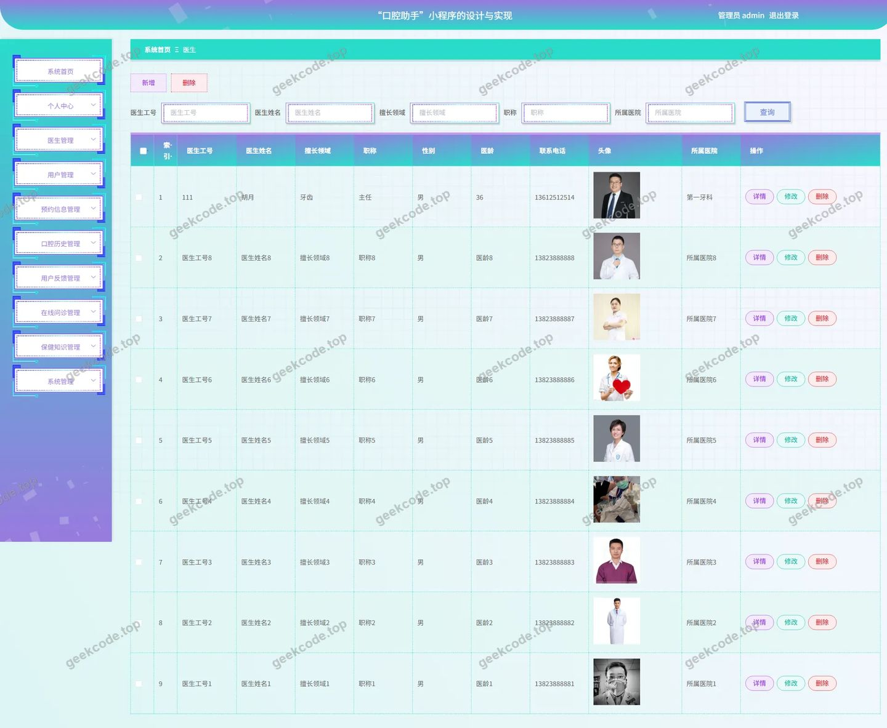</a>

<h4>后台-用户反馈</h4>

<h4>后台-预约信息</h4>

<a href="https://geekcode.top/archives/%E2%80%9C%E5%8F%A3%E8%85%94%E5%8A%A9%E6%89%8B%E2%80%9D%E5%B0%8F%E7%A8%8B%E5%BA%8F%E7%9A%84%E8%AE%BE%E8%AE%A1%E4%B8%8E%E5%AE%9E%E7%8E%B01171u-%E8%AE%BA%E6%96%87?utm_source=github" title="查看完整源码">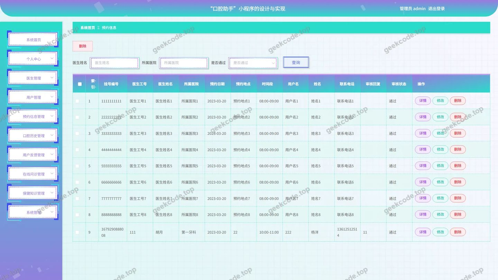</a>

<h4>后台-在线问诊</h4>

<a href="https://geekcode.top/archives/%E2%80%9C%E5%8F%A3%E8%85%94%E5%8A%A9%E6%89%8B%E2%80%9D%E5%B0%8F%E7%A8%8B%E5%BA%8F%E7%9A%84%E8%AE%BE%E8%AE%A1%E4%B8%8E%E5%AE%9E%E7%8E%B01171u-%E8%AE%BA%E6%96%87?utm_source=github" title="查看完整源码">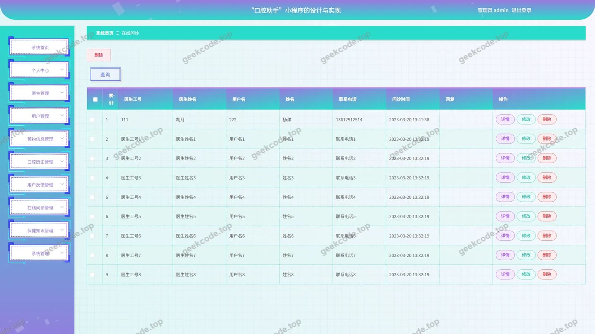</a>

---

## 获取完整源码

| 项目 | 说明 |
| --- | --- |
| 项目名 | “口腔助手”小程序的设计与实现1171u--论文 |
| 运行截图 | 本文 28 张（站点带水印原图，仓库 `images/` 目录） |
| 完整源码 | [https://geekcode.top/archives/%E2%80%9C%E5%8F%A3%E8%85%94%E5%8A%A9%E6%89%8B%E2%80%9D%E5%B0%8F%E7%A8%8B%E5%BA%8F%E7%9A%84%E8%AE%BE%E8%AE%A1%E4%B8%8E%E5%AE%9E%E7%8E%B01171u-%E8%AE%BA%E6%96%87?utm_source=github](https://geekcode.top/archives/%E2%80%9C%E5%8F%A3%E8%85%94%E5%8A%A9%E6%89%8B%E2%80%9D%E5%B0%8F%E7%A8%8B%E5%BA%8F%E7%9A%84%E8%AE%BE%E8%AE%A1%E4%B8%8E%E5%AE%9E%E7%8E%B01171u-%E8%AE%BA%E6%96%87?utm_source=github) |
| 咨询微信 | **ir9372**（备注：jingpin-yuanma） |
| 更多项目 | [极客代码 geekcode.top](https://geekcode.top/?utm_source=github) |

> 需要源码、部署、改配置、跑不起来等问题，加微信 ir9372 沟通，说明项目名即可。
